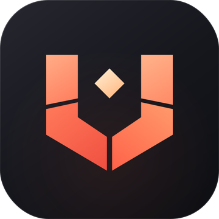
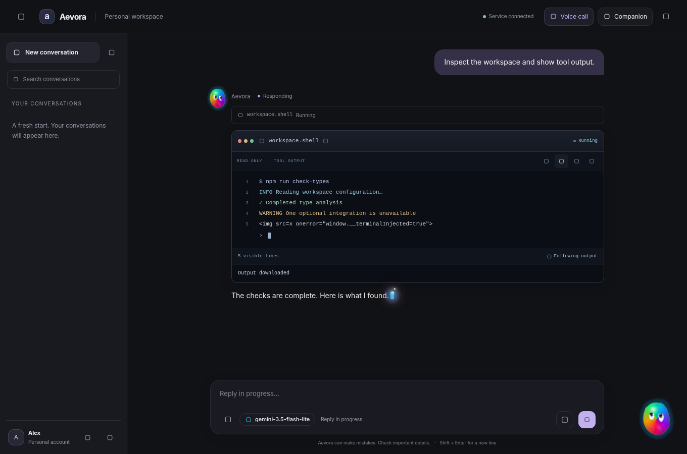
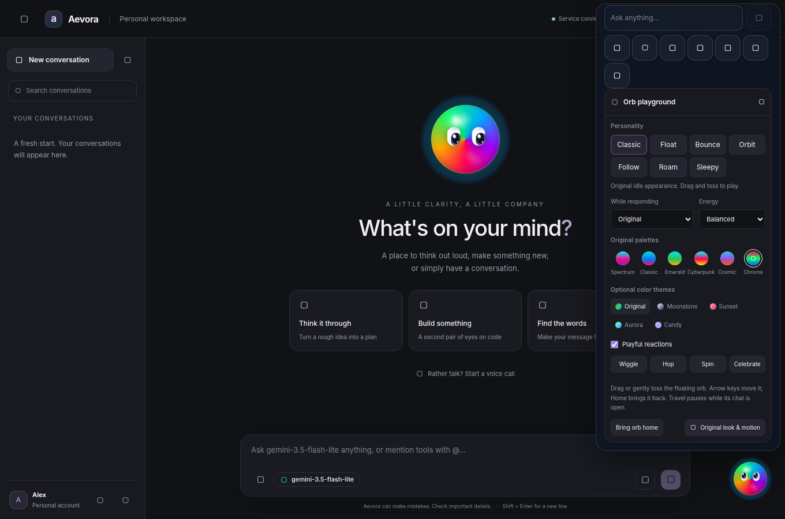
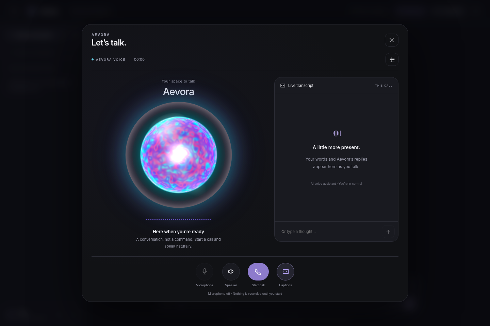
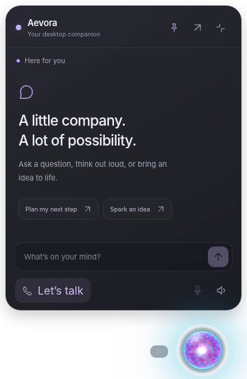
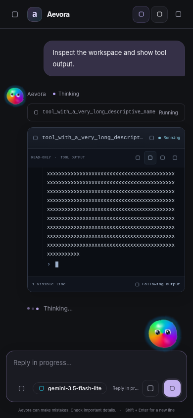

<p align="center">
  
</p>

# Aevora

**Authenticated AI chat with Celery-powered tools and interactive 3D desktop companion.**

_Connect a tool once. Let the team use it from the browser or desktop._

<p align="center">
  
</p>

Aevora combines a Django API, a Next.js frontend, and Gemini-powered chat. The backend discovers tools from a separate Celery worker, selects relevant tools for a prompt, dispatches tool calls through Redis, and streams response events to the client. The tool worker lives in the companion [utils repository](https://github.com/Volcann/utils); it is not started by Aevora's Docker Compose stack.

[The Problem](#the-problem) · [The Solution](#the-solution) · [User Experience](#user-experience) · [The Impact](#the-impact) · [Quick Start](#quick-start) · [Architecture and Boundaries](#architecture-and-boundaries)

---

## The Problem

AI chat can help people use development tools, but giving every person a separate local setup creates repetitive engineering work. Each machine needs the right dependencies, configuration, and credentials. When a tool changes, someone has to update or troubleshoot those setups again.

### The developer time problem

```text
Without a shared tool worker

Developer
   ├── Set up tools for user A
   ├── Set up tools for user B
   ├── Update both when a tool changes
   └── Troubleshoot each local environment
```

People who only need to ask for a PR review or a status report should not have to run the underlying scripts themselves. Developers should not have to maintain a separate copy of the same integration on every user's machine.

---

## The Solution

Aevora puts the chat interface in front of a shared Celery tools worker. Users send requests through an authenticated client. Django asks Gemini to respond, offers the tools relevant to the prompt, and sends selected work to the worker through Redis. The worker runs the task and returns its result; Django streams the response back to the client.

### How a request moves through Aevora

```text
Browser / API client
        |
        v
Django chat API <--> Gemini
        |
        v
Redis (Celery broker and results) <--> tools worker (utils repository)
        |
        v
Django streams answer and tool events via SSE -> client
```

1. An authenticated user sends a prompt to the chat API.
2. Django asks the worker for its `tools.list_tools` registry and caches the returned tool descriptions.
3. The prompt-based selector offers Gemini up to two matching tools.
4. When Gemini calls a tool, Django sends a `tools.<name>` task to the `laptop.tools` Celery queue. Redis provides the broker and result backend.
5. Django streams text, tool status, and completion events over Server-Sent Events (SSE). Chat messages and sessions are stored in PostgreSQL.

### Tools currently available

The current companion worker registers three tools:

| Tool | Purpose |
| --- | --- |
| `setup_project` | Set up a project workspace. |
| `review_pr` | Run the PR review utility for a pull request number. |
| `report_status` | Generate a daily engineering status report. |

For example, a user can ask Aevora to review PR 42. The backend can select `review_pr`, dispatch `tools.review_pr` with that PR number, and stream the result as Gemini prepares its answer.

If the companion worker is unavailable, chat can still run without tools; the tool list will be empty until the worker is started and the cache is refreshed.

---

## User Experience

Aevora provides a full web interface alongside a standalone desktop client featuring interactive 3D WebGL visualizations, real-time tool execution terminals, and floating companion modes:

| AI Chat & Live Terminal Tool Output | Companion Orb Playground & Controls |
| :---: | :---: |
|  |  |

| Interactive 3D Voice Experience | Desktop Companion (Expanded) | Companion Orb (Compact) | Mobile Responsive Chat |
| :---: | :---: | :---: | :---: |
|  |  |  |  |

---

## The Impact

```text
Before:  each user -> local tool setup and updates
After:   users -> Aevora -> one shared tools worker
```

- **Less repeated setup:** Tool code and dependencies are installed with the companion worker rather than on every user's machine.
- **One place to update tools:** Developers can change the worker's registered tasks and refresh Aevora's tool registry once.
- **Simpler access for users:** People use the browser instead of running the utilities from a terminal.
- **Visible progress:** Celery performs tool work while the chat API streams text and task status to the client.

Developers can maintain a shared integration instead of repeating the same setup and support work for each user.

---

## Quick Start

### Prerequisites

- Docker and Docker Compose for the backend services.
- Python and `uv` for the separate tools worker.
- Node.js and npm if you want to run the frontend locally.
- A Gemini API key.

Keep the Aevora and `utils` repositories beside each other for the paths below:

```bash
git clone https://github.com/Volcann/Aevora.git
git clone https://github.com/Volcann/utils.git
```

### 1. Start the backend

```bash
cd Aevora/backend
cp .env.example .env
```

Set `GEMINI_API_KEY` and replace the example application and database secrets in `backend/.env`. Then start the services and apply migrations:

```bash
docker compose up -d --build
docker compose exec -T django python manage.py migrate
```

Docker Compose starts Django, PostgreSQL, Redis, a Celery worker, Celery Beat, and Flower. The Django API is available at `http://127.0.0.1:8002`; check `http://127.0.0.1:8002/api/v1/health/` for readiness. The Compose worker handles Aevora's own tasks; the companion worker below handles the `laptop.tools` queue.

### 2. Start the companion tools worker

In another terminal, from the directory that contains both repositories:

```bash
cd utils
make setup
make worker
```

The worker connects to Redis on `127.0.0.1:6382` and listens to the `laptop.tools` queue. Leave it running while using tool-assisted chat.

### 3. Refresh the tool registry

From `Aevora/backend`, after the companion worker is ready:

```bash
docker compose exec -T django python manage.py reboot_tools
```

This command clears the cached tool registry and loads the tools currently advertised by the worker. Run it again after changing the worker's registered tools.

### 4. Run the frontend (optional)

In another terminal:

```bash
cd Aevora/frontend
npm install
npm run dev
```

Open `http://localhost:3000` for the local frontend. The backend API documentation is at `http://127.0.0.1:8002/api/docs/`.

## Configuration and services

The backend configuration template is [`backend/.env.example`](backend/.env.example). The settings most relevant to this flow are:

| Setting | Use |
| --- | --- |
| `GEMINI_API_KEY` | Gemini chat and function calling. |
| `DATABASE_URL` | PostgreSQL connection for application data. |
| `REDIS_URL` | Redis connection used by Django, Celery, and the task results. |
| `SECRET_KEY`, `JWT_SECRET_KEY` | Application and token signing secrets. |

Docker Compose publishes the backend on `127.0.0.1:8002`, Redis on `127.0.0.1:6382`, and Flower on `127.0.0.1:5557` for local development. The companion worker uses the same Redis instance from the host.

## Architecture and Boundaries

- Chat and tool-list API endpoints require authentication through the Django REST Framework defaults.
- The backend selects tools by matching words in the prompt against tool names and descriptions. This is a routing heuristic, not a per-tool permission system.
- The repository defines a `ToolCall` model, but the current chat execution path does not create per-call audit records. Do not treat that model as an active audit trail.
- The tools worker is a separate process. Starting the Aevora containers alone does not start the worker that serves `laptop.tools`.

The browser does not need the worker's dependencies or credentials. The worker still needs to be running and connected to Redis for tool-assisted chat.

## Useful commands

Run these from `Aevora/backend`:

```bash
docker compose up -d                 # Start backend services
docker compose logs -f django celery # Follow backend and local worker logs
docker compose exec -T django python manage.py reboot_tools # Reload the tool registry
docker compose down                  # Stop backend services
```

Run `make worker` from the sibling `utils` repository to start the companion tools worker.

## Repository layout

```text
Aevora/
├── backend/                 # Django API, Celery worker, Redis, and PostgreSQL
│   ├── aevora/ai_chat/      # Chat API, tool selection, and SSE streaming
│   ├── aevora/accounts/     # Authentication and user accounts
│   ├── config/              # Django settings and API routes
│   ├── docker-compose.yml   # Django, PostgreSQL, Redis, Celery, and Flower
│   └── .env.example         # Local configuration template
├── frontend/                # Next.js web application and shared Turborepo packages
└── electron/                # (Submodule) Standalone Electron desktop client & companion
```

## The Idea in One Sentence

> Aevora lets users request shared development tools through chat while Django routes the work to a Celery worker and streams the results back.
